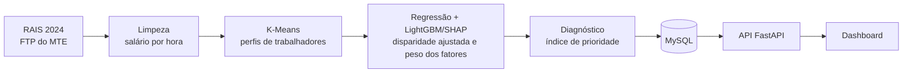

# WageGap AI

Análise da disparidade de renda no mercado de trabalho formal brasileiro, feita com
os microdados da RAIS. O projeto agrupa trabalhadores em perfis, mede quanto da
diferença salarial vem de gênero e raça e não da qualificação, e aponta onde
políticas públicas de capacitação profissional teriam mais impacto.

Projeto Integrador do 4º semestre, alinhado às ODS 5 (Igualdade de Gênero),
8 (Trabalho Decente e Crescimento Econômico) e 10 (Redução das Desigualdades).

## Principais resultados (RAIS 2024, região Norte)

Base: 3.020.326 vínculos formais ativos em 31/12/2024.

| | Diferença direta | Com o mesmo perfil profissional |
|---|---|---|
| Mulheres x homens | elas ganham 0,8% **a mais** | elas ganham **12,8% a menos** |
| Pessoas negras x brancas | ganham 27,2% a menos | ganham **8,4% a menos** |

- No total, as mulheres parecem ganhar igual, mas têm em média um perfil mais
  qualificado. Comparando pessoas com a mesma escolaridade, ocupação, setor, idade
  e local, a diferença aparece.
- A maior parte da diferença racial vem do acesso desigual a escolaridade e a
  cargos melhores. Mesmo assim, sobram 8,4% que o perfil não explica.
- Pelo SHAP, a qualificação pesa 34% na composição do salário e o gênero, 5%.
- As prioridades para capacitação se concentram no polo minerador do sudeste do
  Pará (Canaã dos Carajás, Marabá) e na agropecuária do interior paraense.

O relatório completo está em
[`Pipeline/data/output/2024_norte/diagnostico.md`](Pipeline/data/output/2024_norte/diagnostico.md).

## Como funciona



1. **Coleta e limpeza:** baixa os microdados da RAIS, mantém os vínculos ativos com
   dados válidos e calcula o salário por hora, para comparar jornadas diferentes.
2. **Clusters:** o K-Means agrupa os trabalhadores por escolaridade, idade, jornada,
   ocupação, setor, porte da empresa e tempo de emprego. Sexo e raça ficam de fora,
   para que a diferença salarial dentro de cada perfil não seja explicada pela
   qualificação.
3. **Explicabilidade:** uma regressão linear (equação de Mincer) mede a disparidade
   bruta e a ajustada. Um modelo LightGBM com SHAP mede o peso de cada fator no
   salário.
4. **Diagnóstico:** o modelo simula cada trabalhador mudando uma característica
   (mulher como homem, pessoa negra como branca, sem ensino médio como com ensino
   médio). Os resultados viram um índice de prioridade por município e setor, com o
   público-alvo recomendado.

Detalhes da metodologia e das limitações estão em [`Pipeline/README.md`](Pipeline/README.md).

## Telas do dashboard

| Tela | O que mostra |
|---|---|
| Visão geral | KPIs do recorte (disparidade média, municípios, clusters, trabalhadores) |
| Clusters de perfis | Gráfico de bolhas com a disparidade de gênero e de raça de cada perfil |
| Explicabilidade (SHAP) | Peso de cada fator na renda e disparidade bruta x ajustada, por perfil |
| Ranking | Municípios e setores ordenados pelo índice de prioridade para capacitação |
| Configurações | Senha, tema, idioma (pt/en/es), notificações, 2FA, exportação e exclusão de conta |

Os filtros de UF, setor e ano no topo valem para os KPIs e para o ranking.

## Tecnologias

- **Front-end:** HTML, CSS e JavaScript, servidos pelo Nginx
- **Back-end:** Python com FastAPI
- **Banco:** MySQL 8
- **Dados e IA:** pandas, scikit-learn (K-Means), statsmodels (regressão), LightGBM e SHAP
- **Infraestrutura:** Docker Compose

## Como rodar

Pré-requisito: [Docker Desktop](https://www.docker.com/products/docker-desktop/).

```bash
git clone https://github.com/Rouxxz/WageGap-AI.git
cd WageGap-AI
docker compose up -d --build
```

| Serviço | Endereço |
|---|---|
| Dashboard | http://localhost:8080 |
| API (documentação automática) | http://localhost:8000/docs |
| MySQL | `localhost:3307` (usuário `dev_user`, senha `devpassword`) |

Usuário de teste: `admin@wagegap.ai` / `123456`.

Num banco novo, o dashboard começa só com dados de exemplo. Para carregar os dados
reais, rode o pipeline (próxima seção).

### Rodando o pipeline de dados

```bash
docker compose run --rm pipeline python -m src.run --ano 2024 --regiao NORTE
```

Na primeira execução, o script baixa cerca de 200 MB da RAIS e leva alguns minutos.
Regiões disponíveis: `NORTE`, `NORDESTE`, `CENTRO_OESTE`, `SUL`, `SP` e `MG_ES_RJ`.
Os arquivos de SP e do Sudeste passam de 700 MB e precisam de mais memória no Docker.

Opções úteis:

- `--k 8`: número de clusters (`--k auto` escolhe pelo silhouette)
- `--sem-banco`: só gera os arquivos em `Pipeline/data/output/`
- `--incluir-adm-publica`: coloca a administração pública no índice de prioridade

## Estrutura do repositório

```
WageGap-AI/
├── Back-end/
│   ├── database/init.sql     # tabelas e dados de exemplo
│   └── src/                  # API FastAPI (main.py, routes.py, config.py)
├── Front-end/
│   ├── pages/                # login, cadastro, dashboard, termos
│   └── assets/               # CSS e JavaScript
├── Pipeline/
│   ├── src/                  # extrair, limpar, clusters, explicar, diagnostico, carregar
│   └── data/output/          # resultados por ano e região
└── docker-compose.yml
```

## Principais rotas da API

| Rota | Descrição |
|---|---|
| `GET /api/kpis` | Indicadores do recorte (aceita `uf`, `setor`, `ano`) |
| `GET /api/ranking` | Nichos ordenados pelo índice de prioridade (aceita `uf`, `setor`, `ano`) |
| `GET /api/filtros` | UFs, setores e anos disponíveis no banco |
| `GET /api/clusters` | Perfis com disparidade bruta e ajustada |
| `GET /api/shap` | Peso dos fatores e disparidade bruta x ajustada (`?cluster=id` para um perfil) |
| `POST /api/auth/login` | Login (com 2FA, devolve `requires_2fa` e pede `/api/auth/verify-2fa`) |

A lista completa está em http://localhost:8000/docs.

## Fontes de dados

- [Microdados RAIS e CAGED, Ministério do Trabalho e Emprego](https://www.gov.br/trabalho-e-emprego/pt-br/assuntos/estatisticas-trabalho/microdados-rais-e-caged)
  (FTP: `ftp://ftp.mtps.gov.br/pdet/microdados/RAIS/`)
- [API de localidades do IBGE](https://servicodados.ibge.gov.br/api/docs/localidades), para os nomes dos municípios
- Classificação CNAE 2.0 (IBGE/CONCLA), para os setores

Os microdados da RAIS são públicos e não identificam os trabalhadores.

## Limitações

- A RAIS cobre só o mercado formal.
- A disparidade ajustada mede o que sobra comparando perfis iguais. Ela não prova
  discriminação, porque há fatores que a RAIS não registra.
- Os pesos do índice de prioridade (desigualdade 40%, qualificação 35%, escala 25%)
  são uma escolha de política pública e podem ser ajustados em
  `Pipeline/src/diagnostico.py`.
- Por enquanto, só a região Norte foi processada.
- O login é de demonstração: as senhas ficam sem criptografia e a API não usa token
  de sessão.

## Licença

[MIT](LICENSE)
